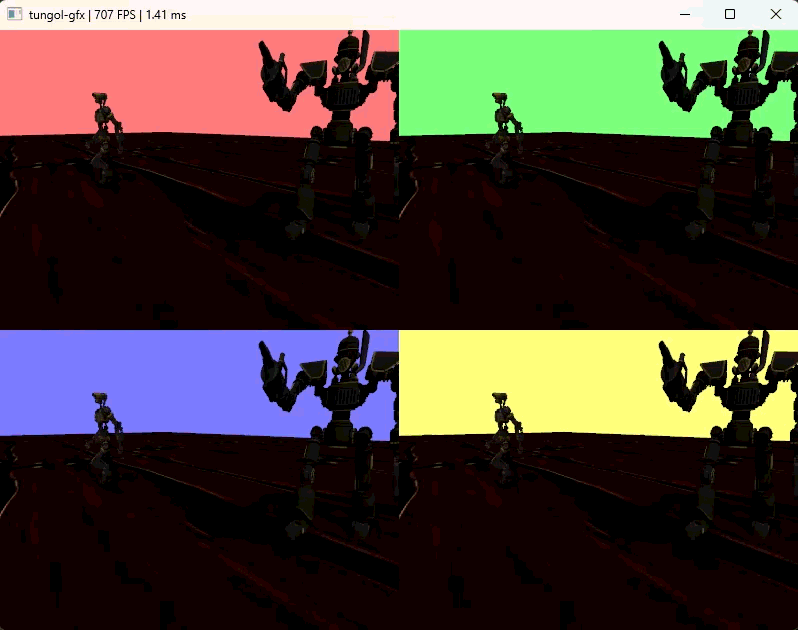

# 🌟 tungol-gfx

A lightweight 3D rendering library built on Vulkan.

**Graphics API:** Vulkan 1.3+
**Dependencies:** GLFW, STB
**Supports:** one PCF shadow map per scene, compute skinning, simple single-light PBR

## Gallery

**1. Big Scene**
[Click here to watch the video](https://drive.google.com/file/d/1PmCZ5xz-tB8QsJdk8oqp5rZLEN8w1HVH/view?usp=sharing)

**2. Small Scene**
[Click here to watch the video](https://drive.google.com/file/d/1JXDGa5iqi0TFMlAGANRtr3gkN80jbZ2-/view?usp=sharing)

**3. 4 Viewports, same Scene**

Code examples are in the `examples/` folder.

## Architecture

See [Architecture.md](docs/Architecture.md) for the design deep-dive.

## Build

Requires CMake and a C++ 23 compiler.