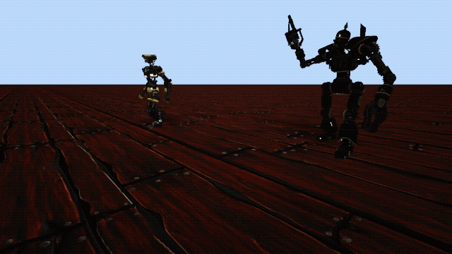
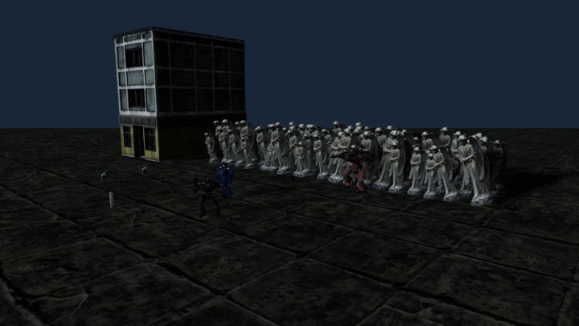

# 🌟 tungol-gfx

A lightweight 3D rendering library built on Vulkan.

| | |
| :--- | :--- |
| **Graphics API** | `Vulkan 1.3+` |
| **Dependencies** | `GLFW` |
| **Supports** | `PCF shadow Map` · `Compute Skinning` · `simple single-light PBR` |

## Gallery

**1. Small Scene**

**2. Big Scene**

Code examples are in the `examples/` folder.

## Architecture

See [Architecture.md](docs/Architecture.md) for the design deep-dive.

## Build

Requires CMake and a C++ 23 compiler.